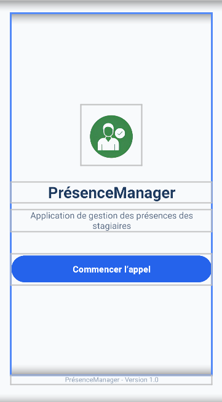

<h1 align="center">PresenceManager</h1>

  <strong>Application Android de gestion des présences des stagiaires</strong>

<h2>Présentation du projet</h2>

  PrésenceManager est une application Android destinée à faciliter
  la gestion des présences des stagiaires dans un établissement
  de formation.

<h2>Technologies utilisées</h2>

<ul>
  <li>Android Studio</li>
  <li>Kotlin</li>
  <li>XML</li>
</ul>

<h2>Interface d'accueil</h2>

  L'application contient une page d'accueil avec :

<ul>
  <li>Le logo de l'application.</li>
  <li>Le titre PrésenceManager.</li>
  <li>Une description de l'application.</li>
  <li>Un bouton « Commencer l'appel ».</li>
</ul>

<h2>Capture d'écran</h2>

  

<h2>Version</h2>

Version 1.0

  <strong>Projet TP01 - M203 Interfaces utilisateurs Android</strong>

